# omarchy-signal

[](https://github.com/iamteedoh/omarchy-signal/actions/workflows/ci.yml)

[](https://github.com/sponsors/iamteedoh)
[](https://patreon.com/iamteedoh)
[](https://buymeacoffee.com/iamteedoh)

Signal messenger for the [Omarchy](https://omarchy.org) desktop: a terminal
client that renders images and links inline, popup notifications you can
answer in place, a tabbed conversation window you can park in the scratchpad,
and a bar widget with your unread count. Everything follows the active
Omarchy theme.

```
 ◢ SIGNAL // OMARCHY  ◉ SECURE                       3 unread ▸ lumon-dark ▸ IMG
 ━━━━━━━━━━━━━━━━━━━━━━━━━━━━━━━━━━━━━━━━━━━━━━━━━━━━━━━━━━━━━━━━━━━━━━━━━━━━━━
   ● Morpheus          1 │ Trinity  +15550002222
     The Oracle will se… │ ╌◢ TX 3 ▰▰▰▱▱▱▱▱ 6 RX ╌ READ 0/3 ╌ ANSWERS ~1m ╌╌╌╌
   ● Tank              2 │ You · 00:33 ✓
     Pick up on the sec… │   Which way out?
 ▌ ● Trinity       00:38 │ Trinity · 00:35 ✓✓
     Tank has the line … │   Tunnel grid 07. Your route is in red, out through exit 04.
   ● Nebuchadnezzar crew │   🖼 tunnel-grid-07.png · 630.5KB
     Van is running. Ba… │ You · 00:37 ✓
                         │   Got it. Heading out now 👍  🔥
                         │ ╌╌╌╌╌╌╌╌╌╌╌╌╌╌╌╌╌╌╌╌╌╌╌╌╌╌╌╌╌╌╌╌╌╌╌╌╌╌╌╌╌╌╌╌╌╌╌╌╌╌╌
                         │ ▌
 Tab list  Ctrl-U contacts  / search  Ctrl-A attach  Ctrl-G message  Ctrl-S settings
```

## Tour

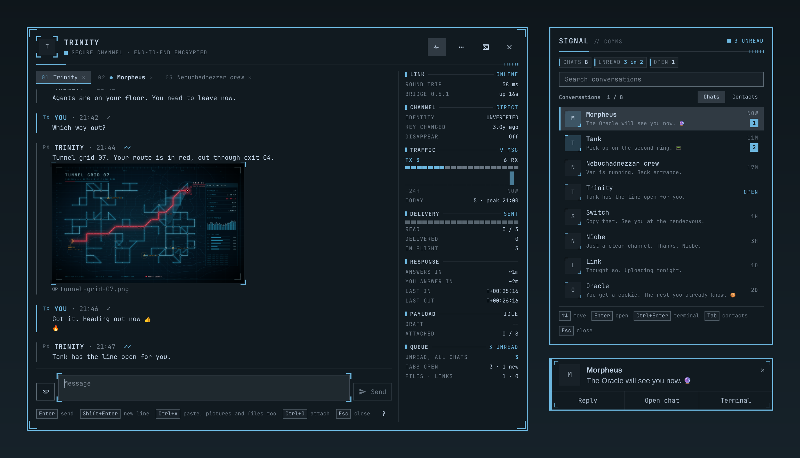

The popup, the reply dialog and the chat window are drawn with Omarchy's own
colours, borders, rounding and fonts, so they change with the theme. Lumon
above; Catppuccin Latte and Gruvbox below.

| | |
|---|---|
| 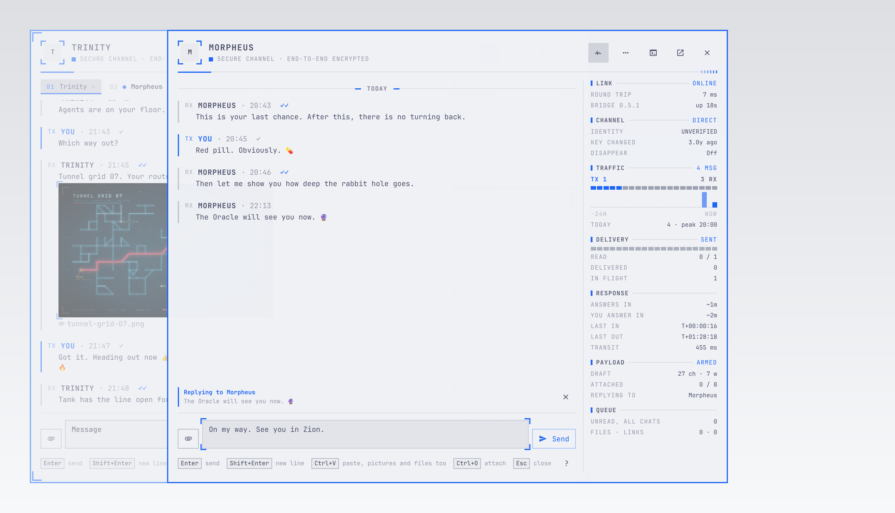 | 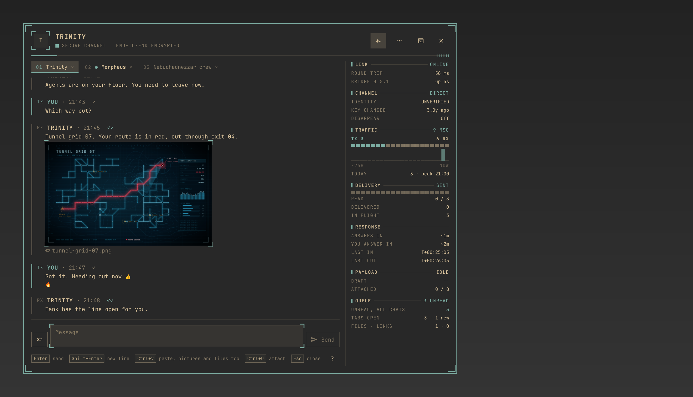 |
| 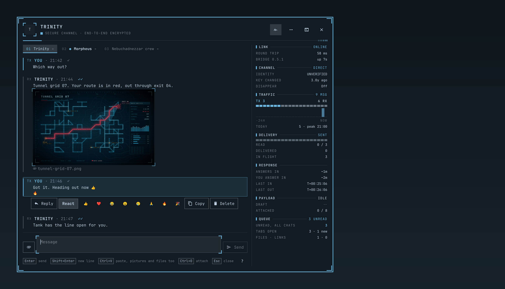 | 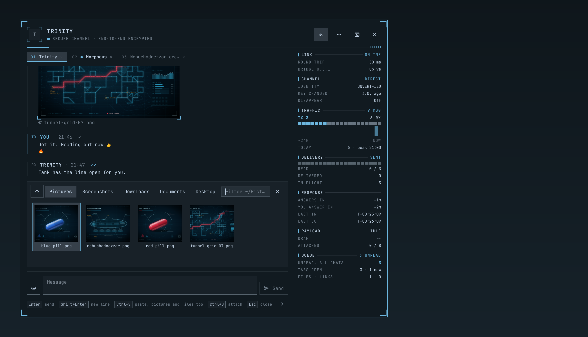 |
| 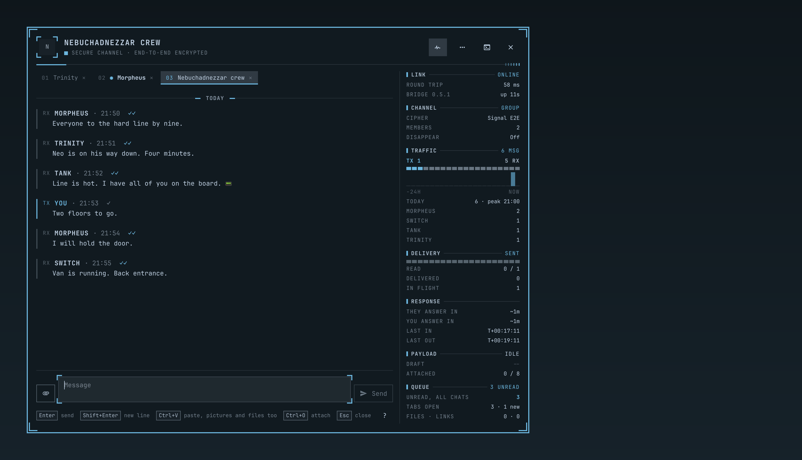 | 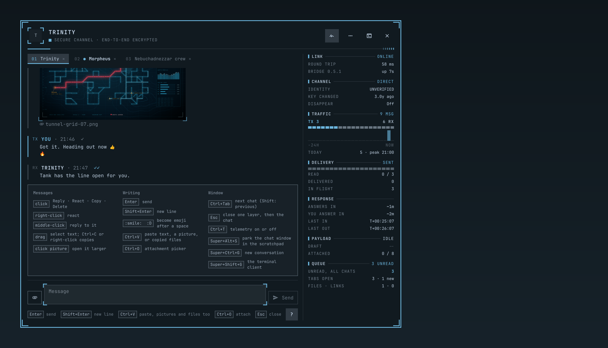 |
| 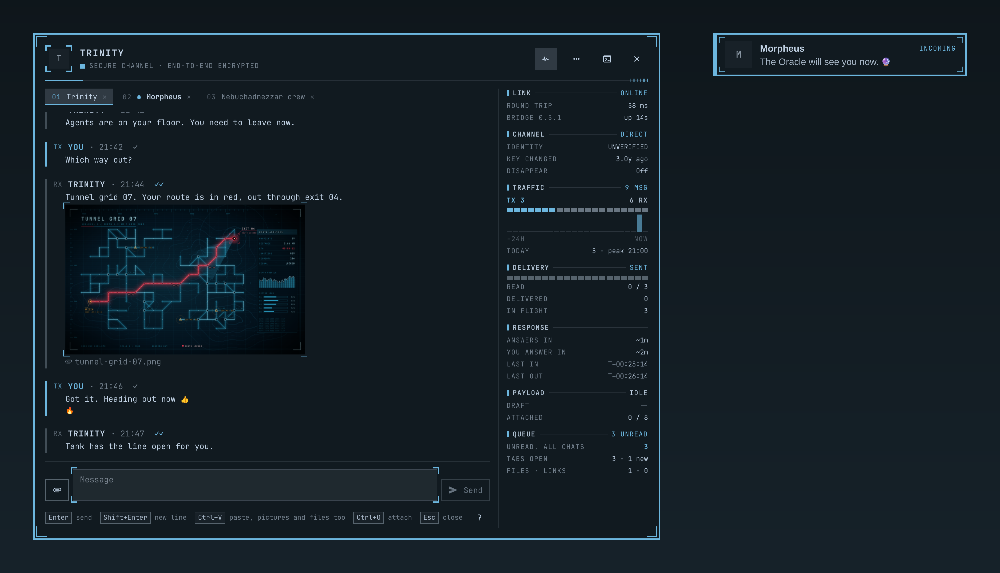 | 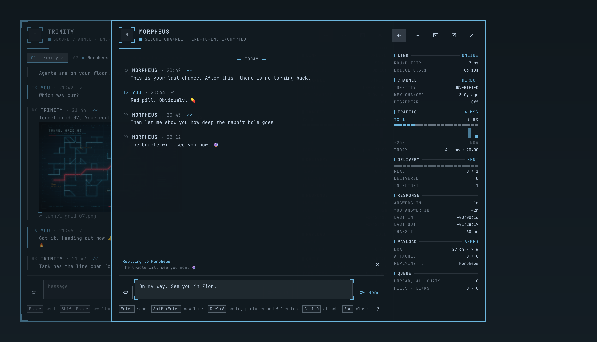 |
| 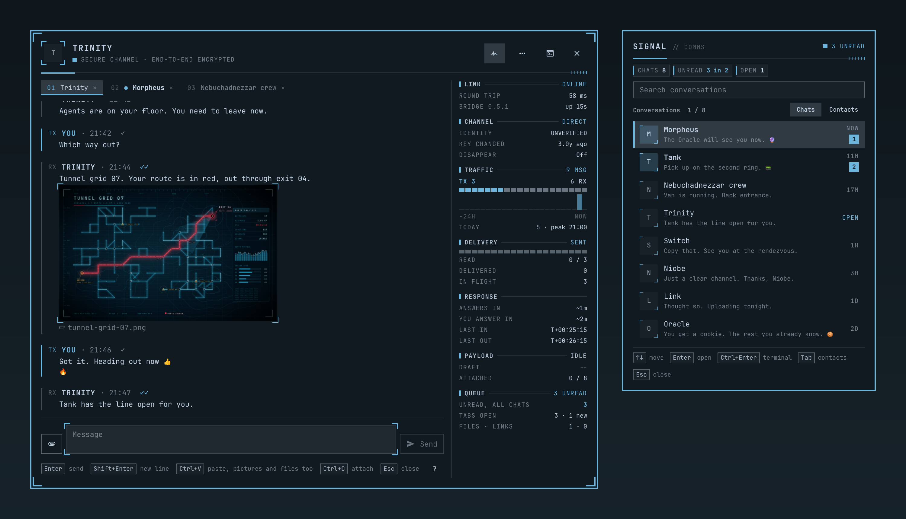 | 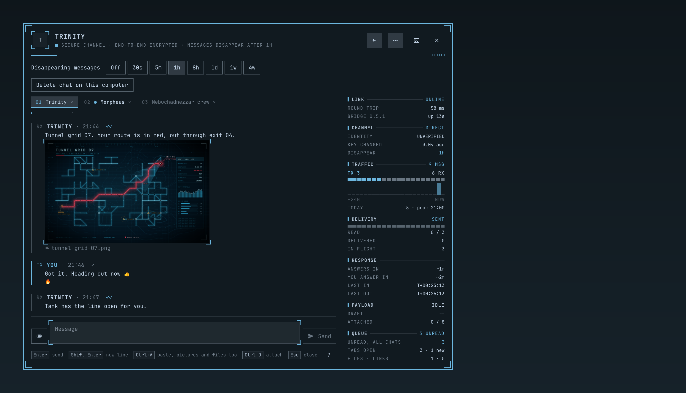 |

The terminal client, in Ghostty with the same theme:

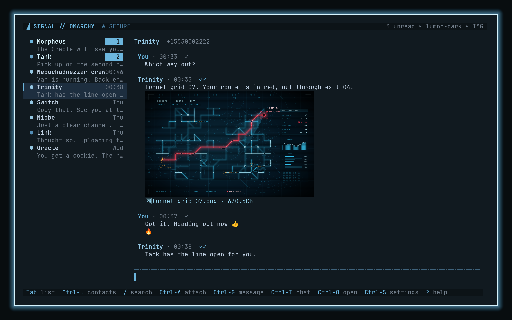

| | |
|---|---|
| 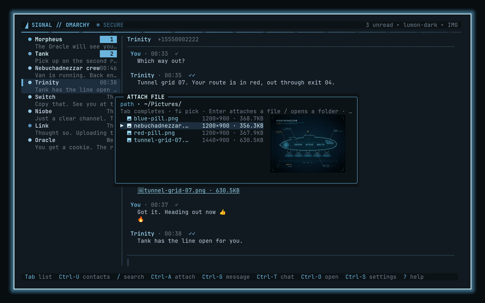 | 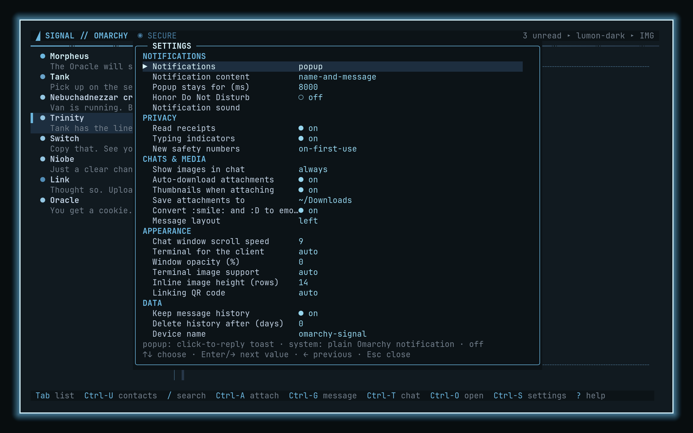 |

Every contact, message and file in these pictures is fictional: they come
from the fake `signal-cli` in `scripts/demo-env.sh`, in a throwaway home
directory. `make screenshots` renders the popups, the chat window and the bar
panel offscreen. `make tui-screenshots` photographs the terminal client in a
private nested Hyprland that runs nothing but one Ghostty, so nothing from
the real desktop can end up in a picture.

## What you get

**Terminal client** (`omarchy-signal tui`, `SUPER+SHIFT+G`)
- Conversations, contacts and groups, history with day separators, delivery and
  read ticks, typing indicators, disappearing-message marks, `@mentions`.
- Images inline through the kitty graphics protocol (Ghostty, kitty, WezTerm);
  URLs and attachments are clickable OSC 8 hyperlinks; text-only elsewhere.
- Emoji shortcodes (`:smile:`) with a picker as you type, and emoticons
  (`:D`, `:)`, `<3`, …); both convert after the space, or send raw (setting).
- Message actions on any message: react, quote/reply, edit, delete for
  everyone or only for you, forward, copy, info. Delete a whole conversation
  from this computer. Attachment menu: open larger, save, save as,
  copy path, show/hide inline.
- Copy and paste with mouse or keyboard: drag to select any text on screen
  (copied when you let go), `Ctrl-V` or right-click to paste, middle-click
  pastes the last selection. A picture on the clipboard becomes an attachment,
  and so do files copied in a file manager.
- Leaves the terminal's own background unpainted, so its opacity and blur show
  through the client the way they do through a shell.
- Conversation menu: disappearing timer, mute, archive, block, message
  requests, safety number with verification, group members, rename, leave,
  new group, Note to Self.
- Attach files with a path prompt that completes as you type, lists the folder,
  and previews the highlighted image.
- A telemetry line under the conversation's title: messages sent and received,
  how many of yours were read, how quickly each side answers, how long since
  the last one came in, and the last 24 hours as a graph. It shows as many
  readings as the width holds. `Alt-T` switches it off and on.
- Settings screen (`Ctrl-S`) grouped like Signal's own client. When a new
  release is out, the client says so and `u` on the settings screen installs
  it and comes back.

**Popups and the chat window** (Quickshell)
- An incoming message slides in top right, drawn like Omarchy's own
  notifications. Hover it for Reply, Open chat and Terminal. Click it: a
  conversation view opens front and centre with the thread, images,
  reply-to-message, reactions, attachments (thumbnail picker), emoji, typing
  indicator.
- **Detach** it, or pick a chat from the bar, and it lives in the **chat
  window**: one real window with a tab per conversation, so Hyprland can float
  it, tile it, or park it in the scratchpad (`SUPER+ALT+S`, back with
  `SUPER+S`). Tabs show unread dots and keep their own draft; `Ctrl+Tab`
  cycles them.
- Delete a message for you or for everyone (within Signal's 24 hours), or a
  whole chat from this computer. Day separators, delivery and read ticks.
- Drawn as an instrument panel: corner brackets on the window, the popups and
  the pictures, a lit rule under the header, a marked edge on every message
  (yours in the accent colour), a scan line when a conversation comes up, a
  light along the composer while a message is being sent.
- **Telemetry** beside the conversation, readable at a glance and worked out
  from what is already on this computer: the link to the bridge (round trip,
  uptime), the contact's safety number (verified or not, and when the key last
  changed), the disappearing timer, messages each way with the last 24 hours
  as a graph, how far your messages got (read, delivered, in flight, failed),
  how quickly each side answers, running counters since the last message in
  and out, what is waiting in the composer, and what is unread in the other
  chats. A narrow window shows the same readings as a row of chips. The pulse
  button in the header or `Ctrl+T` hides it, and the choice is kept.
- Everything follows the active theme (every colour is the theme's own), and
  animations switch off with `omarchy toggle animations`.
- Kinetic trackpad and wheel scrolling with a speed setting.
- Notification content levels (name and message / name only / nothing),
  Do Not Disturb awareness, optional sound.
- Light on the machine: the shell talks to the bridge over its socket instead
  of starting a program per action, so opening a chat costs no process at all.

**Bar widget**: Signal glyph with an unread dot and count. Click for a
searchable list of conversations and contacts (also `SUPER+CTRL+G`): `Enter`
opens the chat window, `Ctrl+Enter` or right-click the terminal client. It
also carries the one thing left to do when there is one: finish setup, link
this computer, or install an update. With telemetry on, a row of readings
says how many chats there are, how much is unread and what is open in the
chat window.

**Command line**: send, react, list, history, status, doctor, settings.

## How it works

```
 phone ──(Signal protocol, E2EE)──► signal-cli ◄──stdio JSON-RPC──► bridge ◄──unix socket──┬── tui / cli
                                    (keys live here)                 (history, sanitising)   └── Quickshell plugin
```

- [`signal-cli`](https://github.com/AsamK/signal-cli) implements the Signal
  protocol with Signal's own `libsignal` and is the only process that holds
  keys or does cryptography. This computer is linked as a secondary device,
  exactly like Signal Desktop.
- The **bridge** (`omarchy-signal bridge`, a systemd user service) runs
  `signal-cli` as a child in JSON-RPC mode, records messages in an owner-only
  SQLite database, and serves clients on a private Unix socket in
  `$XDG_RUNTIME_DIR`. Every string from the network is sanitised before it is
  stored or forwarded; every request from a client is schema-validated.
  Disappearing messages are deleted when their timer runs out.
- The clients only talk to a socket in a private directory, served by a
  process running as you.
- The **terminal client**, the **CLI** and the **Quickshell plugin** are thin
  clients of the bridge, all speaking the same newline-delimited JSON on its
  socket. The plugin never builds a shell string; the few programs it starts
  (file listing, clipboard, window placement) get argv arrays, a deadline and
  a ceiling on what they may print. Text fields never read the clipboard
  themselves: a paste goes through `omarchy-signal paste`, which reads it with
  a size and time limit.

## Install

Requirements: Omarchy 4.x (Quattro), Python ≥ 3.11 (ships with Omarchy),
`signal-cli` from the AUR, `qrencode` (linking) and ImageMagick (image
conversion). Setup offers to install the last three. Inline images in
the terminal need Ghostty, kitty or WezTerm as Omarchy's default terminal
(`omarchy default terminal ghostty`) or `terminal = "ghostty"` in the config.

```bash
omarchy plugin add https://github.com/iamteedoh/omarchy-signal --enable
```

That is Omarchy's own way of adding a plugin: it clones the repository into
`~/.config/omarchy/plugins/iamteedoh.signal` and turns on the bar widget and
the notification service. Because this plugin also needs a command and a
background service, a **Finish setting up Signal** popup appears. Click
**Finish setup** (the bar panel has the same button) and a terminal runs
`install.sh` from the plugin folder, in place: it checks the QML against your
shell, links `~/.local/bin/omarchy-signal`, installs and starts the
`omarchy-signal` user service, adds the keybindings and the menu row, and
offers to link this computer with a QR code. It asks before it installs any
package.

`./uninstall.sh` in the plugin folder reverses all of it (`--purge` also
deletes history).

### Updating

```bash
omarchy plugin update iamteedoh.signal
```

That is Omarchy's own updater: it shows what changed and asks first. The
plugin notices its files changed, refreshes the service unit, keybindings and
hook, restarts the bridge if it was running, and asks you to restart the
shell. It never starts a bridge you had stopped or disabled.

Once a day the plugin looks for a new release tag on the remote it was added
from and says so in a popup and in the bar panel; their Update button, and
`omarchy-signal update`, run the command above. `omarchy-signal update --check`
only reports. `update_check = false` turns the daily check off; nothing but the
tag listing is requested. The plugin never downloads or installs code itself.

An install made by `./install.sh` from a separate checkout is a plain copy
with no git history, which Omarchy cannot update. Update the checkout
(`git pull`) and run `./install.sh` there again, or switch to the plugin
manager: `omarchy plugin remove iamteedoh.signal`, then
`omarchy plugin add https://github.com/iamteedoh/omarchy-signal --enable`.
Your account and history stay where they are either way.

The daily check asks over https first, so it works without an ssh key even
when the plugin was cloned over ssh.

### Developing

```bash
git clone https://github.com/iamteedoh/omarchy-signal ~/git/omarchy-signal
cd ~/git/omarchy-signal
./install.sh          # copies this checkout into the plugin folder and sets it up
                      # (--link symlinks the checkout instead; see docs/STATUS.md before using it)
```

### Dependencies and permissions

External programs: `signal-cli` (AUR `signal-cli-native-bin`; holds the
account keys and does every cryptographic operation), `qrencode` (linking
QR), ImageMagick (image conversion), and optionally `wl-clipboard` (copy and paste), `pw-play` and
`xdg-open`. The installer asks before installing any of them; package
installation is the only step that touches the system outside your home
directory, and it goes through Omarchy's own `omarchy-pkg-add` and
`omarchy-pkg-aur-add`. The installer never calls `sudo` or a package manager
itself: without those commands it lists what is missing and stops. Everything else, including the user-level
systemd service, lives under `$HOME`, `$XDG_RUNTIME_DIR` and
`~/.config/omarchy`. The plugin never overwrites your `shell.json`,
bindings or menu files; it appends clearly marked blocks that
`uninstall.sh` removes again.

## Keyboard shortcuts

### Desktop (Hyprland)

| Key | Action |
|-----|--------|
| `SUPER+SHIFT+G` | open or focus the terminal client |
| `SUPER+CTRL+G` | new conversation: the bar's searchable contact picker |
| `SUPER+ALT+S` / `SUPER+S` | park the chat window in the scratchpad / bring it back (Omarchy defaults) |
| `SUPER+W` | close the popup conversation (or the linking QR code) while one is on screen; otherwise closes the active window as usual |

### Terminal client

| Key | Action |
|-----|--------|
| `Enter` / `Alt-Enter` | send / new line |
| `Tab` | focus the conversation list (`j`/`k`, `Enter`; `w` detaches; `m` mutes) |
| `Alt-↑/↓`, `Ctrl-N/P`, `Alt-1…9` | switch conversation |
| `PgUp`/`PgDn`, mouse wheel | scroll, loads older history |
| `Ctrl-U` | contacts and groups (start a conversation; "me" is Note to Self) |
| `/` | search history |
| `Ctrl-A` | attach: path prompt with Tab completion, folder listing and image preview |
| `Ctrl-G` | pick any message: react, quote, edit, delete for everyone (`d`) or for me (`D`), forward, copy, open, info |
| `Ctrl-R` / `Ctrl-Q` | react to / quote the last message |
| `Ctrl-O`, or click an attachment or picture | open larger, save to `~/Downloads`, save as…, copy path, show/hide inline |
| `Ctrl-T` | conversation: detach into the chat window, disappearing messages, mute, archive, block, message request, safety number (`v` verifies), group members/rename/leave, new group, archived chats |
| `Alt-D` | detach this chat into the chat window |
| `Alt-T` | telemetry line on or off |
| `Ctrl-E` | mute conversation |
| `:smile:` / `:D` | emoji shortcodes and emoticons convert after the space (setting); a picker opens as you type |
| `Ctrl-S` / `F2` | settings (`u` there installs an available update, `r` restarts the bridge after a restart-only change) |
| `Ctrl-Z` | put a failed message back in the composer |
| `Ctrl-X` / `Ctrl-L` | clear composer / redraw |
| drag with the mouse | select text; copied to the clipboard (and the primary selection) on release |
| `Ctrl-C` | copy the selection; with nothing selected, quit |
| `Ctrl-V`, right-click | paste into the composer or the open prompt; a picture or copied files on the clipboard are attached |
| `SUPER+V`, `Shift-Insert`, `Ctrl-Shift-V` | paste text (the terminal does this paste itself, and terminals paste text only) |
| middle-click | paste the primary selection |
| `?` | help |

### Popup and chat window

| Key or mouse | Action |
|--------------|--------|
| click a message | action row: Reply · React (quick emojis) · Copy · Delete (for me, or for everyone within 24 hours) |
| drag across message text | select it; `Ctrl+C` / `SUPER+C` or a right-click on it copies (Copy then copies just the selection) |
| right-click a message | reactions |
| middle-click a message | reply to it |
| click a picture | open it larger |
| `Enter` / `Shift+Enter` or `Alt+Enter` | send / new line; the message box grows to 10 lines, then scrolls (shortcodes and emoticons convert after the space) |
| `Ctrl+V` / `SUPER+V`, `Shift+Insert`, right-click the message field | paste; a picture or copied files on the clipboard are attached |
| middle-click the message field | paste the primary selection |
| `Ctrl+O` / `Ctrl+Shift+A` / 󰁦 | attachment picker: arrows move, `Enter` attaches, `Backspace` on an empty filter goes up a folder |
| `Ctrl+Tab` / `Ctrl+Shift+Tab`, click a tab | switch conversation tab; ✕ closes a tab |
| `Ctrl+T`, or the pulse button in the header | telemetry on or off (the setting is kept, and the terminal client follows it) |
| `Esc` | closes one layer at a time: shortcut list → picker → menus → text selection → message actions → quote → window (`SUPER+W` closes the popup at once) |
| `?` | every shortcut |
| header buttons | telemetry · conversation menu (disappearing messages timer, delete chat) · open the terminal client · move the popup into the chat window · close |

### Bar panel

| Key or mouse | Action |
|--------------|--------|
| type | filter conversations or contacts |
| `↑`/`↓`, `PgUp`/`PgDn` | move |
| `Enter`, click | open in the chat window |
| `Ctrl+Enter`, right-click | open in the terminal client |
| `Tab` | switch between conversations and contacts |
| `Esc` | clear the filter, then close |

## Settings

`Ctrl-S` in the client, or `omarchy-signal settings [key [value]]`. Live keys
apply immediately to the client, the bridge and the popups; the few marked
(restart) need `systemctl --user restart omarchy-signal` (the settings screen
offers `r`). File: `~/.config/omarchy-signal/config.toml`
([`docs/config.example.toml`](docs/config.example.toml)).

| Section | Key | Values / meaning |
|---------|-----|------------------|
| Notifications | `notifications` | `popup` (click-to-reply toast) · `system` · `off` |
| | `notification_content` | `name-and-message` · `name-only` · `none` (like Signal) |
| | `notification_timeout_ms` | how long a popup stays |
| | `respect_dnd` | no popups while Omarchy's Do Not Disturb is on |
| | `notification_sound` | audio file played with a popup (empty = silent) |
| Privacy | `send_read_receipts` | also what clears the notification on your phone |
| | `typing_indicators` | send and show |
| | `trust_new_identities` | `on-first-use` · `always` · `never` (restart) |
| Chats & media | `inline_images` | `always` · `click` · `never` |
| | `download_attachments` | auto-fetch attachments (restart) |
| | `attachment_thumbnails` | tiles or a plain list in the picker |
| | `save_dir` | where the attachment menu saves |
| | `emoji_autoconvert` | `:smile:` and `:D` → emoji; off sends them raw |
| | `message_layout` | `left` · `bubbles` |
| Appearance | `scroll_speed` | chat window trackpad/wheel multiplier (0 = Qt default) |
| | `window_opacity` | how solid the popup conversation and chat window are, in percent (0 = follow the theme) |
| | `telemetry` | the readings beside a conversation in the chat window, in the bar panel and in the terminal client |
| | `terminal` | `auto` (Omarchy default) · `ghostty` · `kitty` · `wezterm` · `foot` · `alacritty` |
| | `terminal_images`, `image_max_rows` | inline image support and height |
| | `qr_style` | linking QR: `auto` (shell popup) · `shell` · `image` · `half` · `quad` · `braille` |
| Data | `history_enabled`, `history_retain_days` | local history (restart), retention |
| | `device_name` | shown in Signal's Linked devices (restart) |
| | `update_check` | look for a new release tag once a day |

## Command line

```bash
omarchy-signal tui [chat] [--new]          # terminal client (--new: contact picker)
omarchy-signal open [chat] [--new]         # open or focus the client in a terminal window
omarchy-signal window [chat]               # open a chat in the tabbed chat window
omarchy-signal send "Trinity" -m "on my way" [-a photo.jpg] [--quote-ts …]
omarchy-signal react <chat> <ts> <author> 🔥
omarchy-signal delete <chat> <ts> [--everyone]   # for me by default; nothing is sent
omarchy-signal delete-chat <chat>          # from this computer only
omarchy-signal update [--check] [--yes]    # is there a newer release? then runs omarchy plugin update
omarchy-signal conversations | contacts [--refresh] | history <chat> -n 30
omarchy-signal mark-read <chat>            # also clears the phone's notification
omarchy-signal link [--force] [--qr-style …]
omarchy-signal settings [key [value]]
omarchy-signal events [--once]             # the bridge's event stream as JSON lines
omarchy-signal status | doctor | demo
```

Recipients accept a contact name, `+number`, `username.NN`, `group:ID`, a
conversation key, or `me` for Note to Self. Add `--json` for machine output.

## Surviving Omarchy updates

Everything the installer places lives under your home directory, which
`omarchy update` does not rewrite. The installer also drops a post-update hook
(`~/.config/omarchy/hooks/post-update.d/omarchy-signal`) that re-checks the
plugin still loads against the new shell and that the bridge service is still
installed, and raises a critical notification if anything needs attention;
`omarchy-signal doctor` gives the details. The hook only reports: if you have
disabled or masked the bridge service, it stays off after an update. A manual `omarchy refresh shell`
resets `shell.json` (dropping the bar widget); re-run `./install.sh` after it.

## Security

To report a vulnerability privately, follow [SECURITY.md](SECURITY.md); please
do not open public issues for security problems. The same file has the threat
model and what is and is not protected. Short version: end-to-end encryption
is `libsignal`'s, untouched; this project's job is to never let a message
from a stranger do anything to your terminal, your shell or your files.

## Tests

```bash
make test          # python unit + integration tests (fake signal-cli), node tests, shell checks, QML load check
make screenshots      # re-render preview.png and docs/media offscreen, from the demo bridge
make tui-screenshots  # re-take the terminal client pictures in a private nested Hyprland
make security      # the adversarial subset: terminal injection, path traversal, protocol abuse
```

## Status

Released: the current version is on the
[Releases](https://github.com/iamteedoh/omarchy-signal/releases) page and in
`manifest.json`. It runs daily against a real account (linking, sending,
receiving, attachments, receipts, reactions, the popups and the chat
window). Install it with `omarchy plugin add` as described above; it is
listed on [plugins.omarchy.org](https://plugins.omarchy.org/plugin.html?id=iamteedoh.signal). Known issues live in [`docs/STATUS.md`](docs/STATUS.md); bugs and
ideas go in the [issues](https://github.com/iamteedoh/omarchy-signal/issues).

## Contributing

Contributions are welcome. See [CONTRIBUTING.md](CONTRIBUTING.md) for local
setup, the validation suite, and the pull request process.

## Support the Project

omarchy-signal is free software built in my spare time. If it's useful to
you, consider supporting development:

- ❤ [GitHub Sponsors](https://github.com/sponsors/iamteedoh)
- 🧡 [Patreon](https://patreon.com/iamteedoh)
- ☕ [Buy Me a Coffee](https://buymeacoffee.com/iamteedoh)

Stars, bug reports, and pull requests are just as appreciated!

## License

GNU General Public License v3.0 or later. See [LICENSE](LICENSE).
Every source file carries an `SPDX-License-Identifier: GPL-3.0-or-later`
header. `signal-cli` (GPL-3.0) and Quickshell are separate programs this
plugin talks to; they are not bundled.
